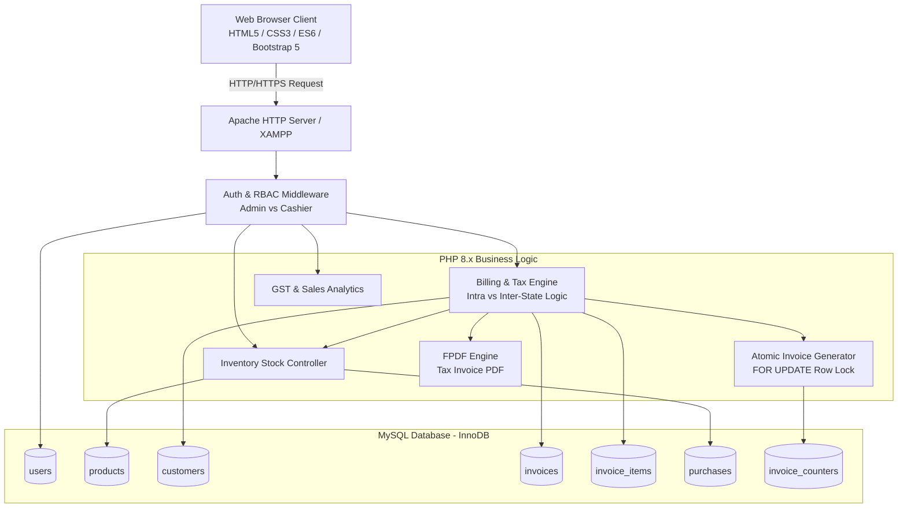
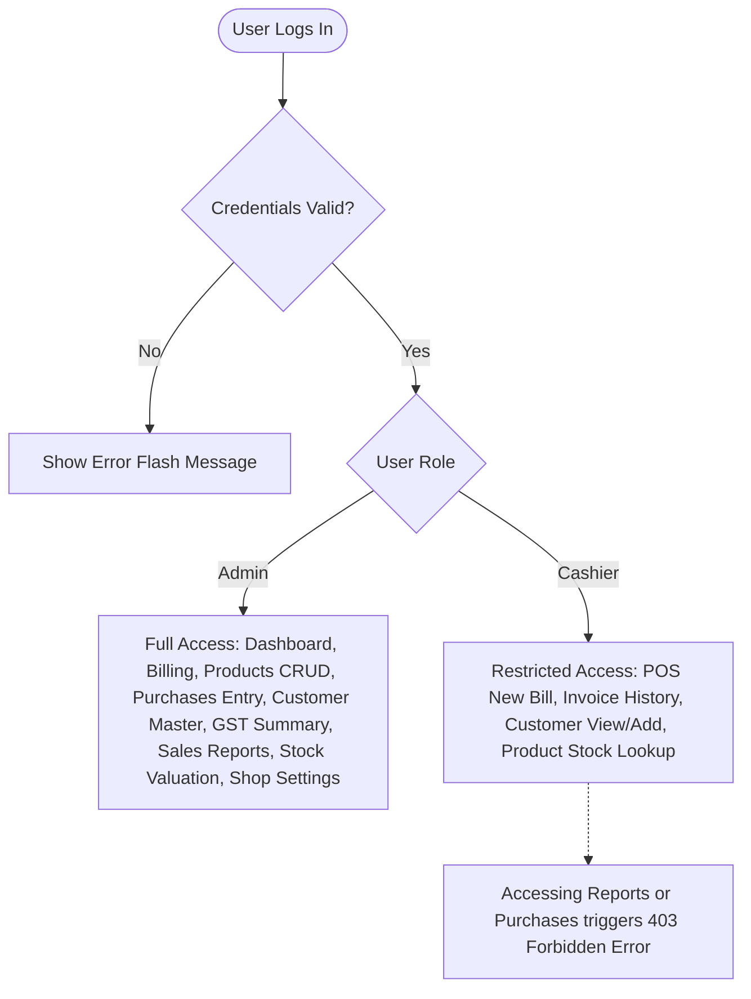
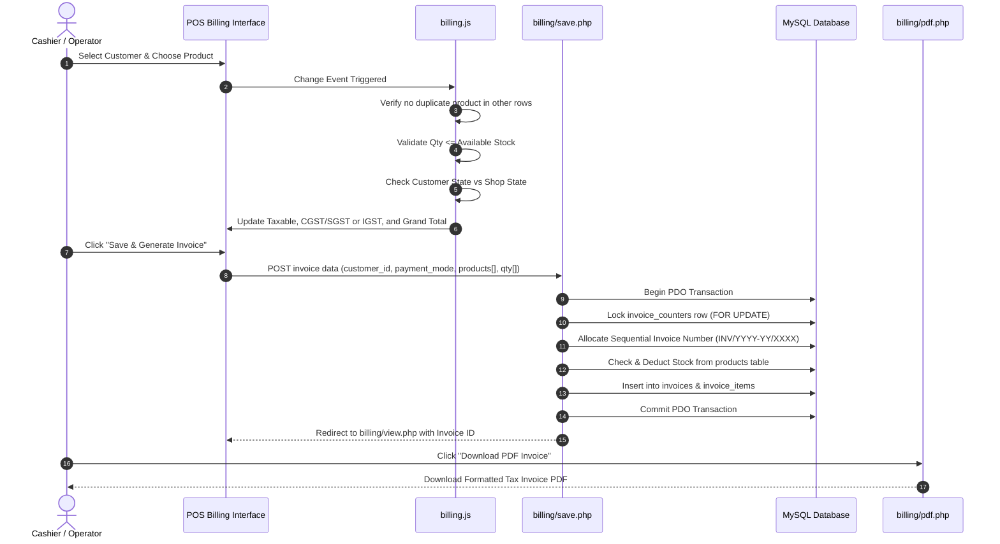
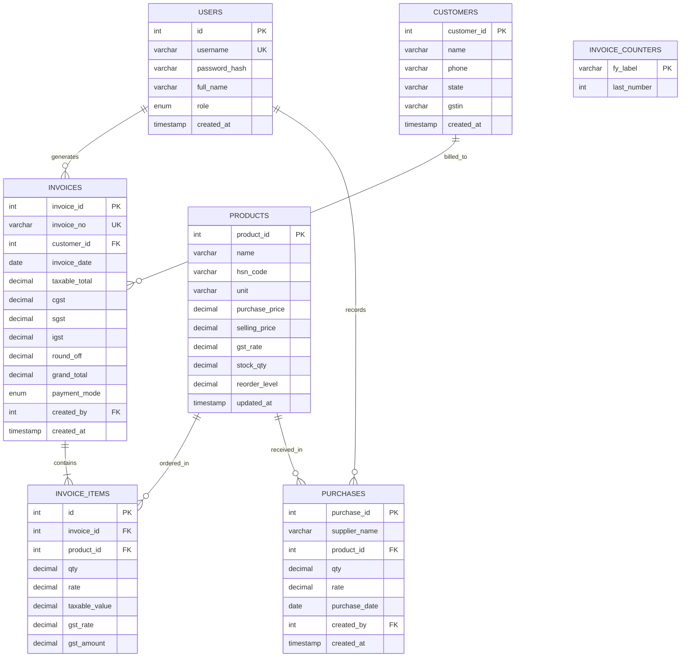

# Academic Project Documentation Report
## GST Billing & Automated Inventory Management System ("Stockify")

---

### Project Metadata
- **Project Title**: Web-Based GST Billing, Stock Tracking & Automated Financial Accounting System
- **Domain**: Enterprise Web Applications / ERP & Financial Computing
- **Target Audience**: Micro, Small & Medium Enterprises (MSMEs), Retailers, Wholesale Distributors
- **Academic Standard**: Capstone / Final Year Project Report Specification

---

## 1. Executive Summary

In traditional retail and wholesale environments, billing and inventory operations are often fragmented. Manual ledger entries, delayed stock reconciliation, and mathematical errors during Goods and Services Tax (GST) calculations frequently result in regulatory non-compliance and financial discrepancies.

**Stockify** is an enterprise-grade, cloud-ready web application designed to automate point-of-sale billing, real-time inventory tracking, and GST tax compliance for commercial establishments. The system dynamically computes **Intra-State (CGST + SGST)** and **Inter-State (IGST)** tax liabilities based on customer geographic profiling, automatically updates inventory using atomic ACID-compliant transactions, provides automated low-stock warnings, and generates standardized PDF Tax Invoices compliant with Indian GST laws.

---

## 2. Tools & Technologies Used

### 2.1 Technology Stack Overview

| Category | Technology | Version | Purpose / Implementation |
| :--- | :--- | :--- | :--- |
| **Frontend Structure** | HTML5 | Living Standard | Semantic document outline, accessible forms, responsive grid tables |
| **Styling & Design** | CSS3 & Vanilla CSS | CSS3 | Custom design system (`style.css`), modern glassmorphism, responsive cards, stepper UI |
| **UI Framework** | Bootstrap | v5.3.3 | Grid layout, responsive utilities, modals, badge components |
| **Iconography** | Bootstrap Icons | v1.11.3 | Vector icon library for POS controls, navigational cues, and status badges |
| **Client-Side Scripting** | JavaScript (ES6+) | Modern ECMAScript | Dynamic billing row generation, client-side duplicate prevention, live tax math |
| **Backend Language** | PHP | 8.1+ / 8.2+ | Server-side routing, session management, transaction orchestration, data sanitization |
| **Database Engine** | MySQL / MariaDB | 8.0+ / 10.4+ | Relational data persistence, InnoDB engine, foreign keys, row-level locking |
| **Database Abstraction** | PHP Data Objects (PDO) | Core PHP | Parameterized queries, transaction management (`beginTransaction`, `commit`, `rollback`) |
| **PDF Generation** | FPDF | v1.86 | Server-side programmatic PDF invoice rendering with tabular layouts |
| **Local Web Server** | Apache (XAMPP) | v2.4+ | Local HTTP server and development runtime environment |
| **Containerization** | Docker | Latest | Multi-stage Dockerfile for containerized deployment |
| **Cloud Deployment** | Render | PaaS | Cloud platform hosting via `render.yaml` specification |

---

## 3. System Architecture & Workflows

### 3.1 Architectural Pattern
The application follows a **Modular MVC-Inspired Tiered Client-Server Architecture**:
1. **Presentation Layer (Client)**: Modern HTML5/CSS3/JavaScript interface providing real-time calculations, input validation, and user feedback.
2. **Application / Business Logic Layer (Server)**: PHP controller endpoints that authenticate users, enforce role-based access control (RBAC), enforce business rules (stock deductions, tax rate determination), and orchestrate invoice sequencing.
3. **Data Layer (Storage)**: Relational MySQL database adhering to 3NF (Third Normal Form) with strict foreign key constraints and transactional integrity.



---

### 3.2 Role-Based Access Control (RBAC)

The system enforces strict permission boundaries based on user roles:



---

### 3.3 End-to-End Billing Lifecycle



---

## 4. Database Design & Data Dictionary

### 4.1 Entity-Relationship Diagram (ERD)



---

### 4.2 Data Dictionary

#### Table 1: `users`
| Column | Type | Nullable | Default | Description |
| :--- | :--- | :--- | :--- | :--- |
| `id` | `INT` | No | Auto Increment | Primary Key |
| `username` | `VARCHAR(50)` | No | None | Unique login username |
| `password_hash` | `VARCHAR(255)` | No | None | Bcrypt password hash (`password_hash()`) |
| `full_name` | `VARCHAR(100)` | No | None | Display name of the user |
| `role` | `ENUM('admin','cashier')` | No | `'cashier'` | Access control authorization level |
| `created_at` | `TIMESTAMP` | No | `CURRENT_TIMESTAMP` | Account registration timestamp |

#### Table 2: `products`
| Column | Type | Nullable | Default | Description |
| :--- | :--- | :--- | :--- | :--- |
| `product_id` | `INT` | No | Auto Increment | Primary Key |
| `name` | `VARCHAR(100)` | No | None | Product title / description |
| `hsn_code` | `VARCHAR(10)` | No | None | Harmonized System of Nomenclature code |
| `unit` | `VARCHAR(10)` | No | `'nos'` | Measurement unit (nos, kg, litre, meter) |
| `purchase_price`| `DECIMAL(10,2)` | No | `0.00` | Inward acquisition cost per unit |
| `selling_price` | `DECIMAL(10,2)` | No | `0.00` | Base selling price per unit |
| `gst_rate` | `DECIMAL(4,2)` | No | `0.00` | Applicable GST percentage (0%, 5%, 12%, 18%, 28%) |
| `stock_qty` | `DECIMAL(10,2)` | No | `0.00` | Current real-time available stock balance |
| `reorder_level` | `DECIMAL(10,2)` | No | `0.00` | Threshold that triggers low-stock alerts |

#### Table 3: `customers`
| Column | Type | Nullable | Default | Description |
| :--- | :--- | :--- | :--- | :--- |
| `customer_id` | `INT` | No | Auto Increment | Primary Key |
| `name` | `VARCHAR(100)` | No | None | Customer name or company title |
| `phone` | `VARCHAR(15)` | Yes | `NULL` | Contact phone number |
| `state` | `VARCHAR(50)` | No | None | Indian State / UT for GST classification |
| `gstin` | `VARCHAR(15)` | Yes | `NULL` | 15-character GST Identification Number |

#### Table 4: `invoices`
| Column | Type | Nullable | Default | Description |
| :--- | :--- | :--- | :--- | :--- |
| `invoice_id` | `INT` | No | Auto Increment | Primary Key |
| `invoice_no` | `VARCHAR(20)` | No | None | Unique sequential code (e.g., `INV/2026-27/0001`) |
| `customer_id` | `INT` | No | None | Foreign Key referencing `customers(customer_id)` |
| `invoice_date` | `DATE` | No | None | Date of invoice issuance |
| `taxable_total`| `DECIMAL(12,2)` | No | `0.00` | Cumulative line item value before GST |
| `cgst` | `DECIMAL(12,2)` | No | `0.00` | Central GST amount (Intra-state only) |
| `sgst` | `DECIMAL(12,2)` | No | `0.00` | State GST amount (Intra-state only) |
| `igst` | `DECIMAL(12,2)` | No | `0.00` | Integrated GST amount (Inter-state only) |
| `round_off` | `DECIMAL(12,2)` | No | `0.00` | Adjustment to achieve nearest integer total |
| `grand_total` | `DECIMAL(12,2)` | No | `0.00` | Final payable amount |
| `payment_mode` | `ENUM('cash','upi','card')` | No | `'cash'` | Method of settlement |
| `created_by` | `INT` | No | None | User ID of the cashier/admin |

#### Table 5: `invoice_items`
| Column | Type | Nullable | Default | Description |
| :--- | :--- | :--- | :--- | :--- |
| `id` | `INT` | No | Auto Increment | Primary Key |
| `invoice_id` | `INT` | No | None | Foreign Key referencing `invoices(invoice_id)` |
| `product_id` | `INT` | No | None | Foreign Key referencing `products(product_id)` |
| `qty` | `DECIMAL(10,2)` | No | None | Quantity billed |
| `rate` | `DECIMAL(10,2)` | No | None | Unit price applied |
| `taxable_value`| `DECIMAL(12,2)` | No | None | `qty * rate` |
| `gst_rate` | `DECIMAL(4,2)` | No | None | GST percentage at billing time |
| `gst_amount` | `DECIMAL(12,2)` | No | None | `(taxable_value * gst_rate) / 100` |

#### Table 6: `purchases`
| Column | Type | Nullable | Default | Description |
| :--- | :--- | :--- | :--- | :--- |
| `purchase_id` | `INT` | No | Auto Increment | Primary Key |
| `supplier_name`| `VARCHAR(100)` | No | None | Vendor / Supplier name |
| `product_id` | `INT` | No | None | Inward stock item ID |
| `qty` | `DECIMAL(10,2)` | No | None | Units purchased (added to stock) |
| `rate` | `DECIMAL(10,2)` | No | None | Purchase rate per unit |
| `purchase_date`| `DATE` | No | None | Inward receipt date |
| `created_by` | `INT` | No | None | User who recorded the purchase |

#### Table 7: `invoice_counters`
| Column | Type | Nullable | Default | Description |
| :--- | :--- | :--- | :--- | :--- |
| `fy_label` | `VARCHAR(10)` | No | None | Financial Year identifier (e.g., `'2026-27'`) |
| `last_number` | `INT` | No | `0` | Sequential increment tracker |

---

## 5. Detailed Module Analysis

### Module 1: Authentication & Authorization (`includes/auth.php`)
- **Bcrypt Encryption**: User passwords are stored using salted cryptographic one-way hashes via `password_hash($pass, PASSWORD_BCRYPT)`.
- **Session Protection**: Validates user state through PHP native sessions; terminates on inactivity or explicit logout.
- **Role Verification**: Functions `requireLogin()` and `requireRole('admin')` guard restricted endpoints and redirect unauthorized actions to custom HTTP 403 pages.

### Module 2: Smart POS Billing Engine (`billing/new.php`, `assets/js/billing.js`)
- **Client-Side Duplicate Interception**:
  - Dynamically synchronizes product dropdowns across all active rows.
  - Automatically disables already-selected products in remaining dropdowns.
  - Reverts accidental duplicate selections, triggers a non-disruptive warning banner, and pulses the existing row to focus the user on adjusting quantity.
- **Quantity Stepper & Live Stock Feedback**:
  - Replaces default input spinners with responsive `[-]` and `[+]` stepper buttons.
  - Compares input quantity against available `stock_qty` in real time.
  - Displays instant visual warnings (`is-invalid` border, red badge) when quantity exceeds warehouse stock.
- **Dynamic Tax Resolution**:
  - Evaluates Customer State against Shop State (`SHOP_STATE`).
  - Automatically toggles between **Intra-State GST (CGST + SGST split 50:50)** and **Inter-State GST (100% IGST)** without requiring page reload.

### Module 3: Atomic Transaction Billing Processor (`billing/save.php`)
- **ACID Transaction Guarantees**:
  - Executes invoice persistence, counter increment, and stock decrement within a single `PDO::beginTransaction()`.
  - Employs `SELECT ... FOR UPDATE` row-level locks on `invoice_counters` to guarantee gap-free, collision-free invoice numbering under concurrent cashier workloads.
  - Auto-merges quantities if identical product IDs are submitted and executes `ROLLBACK` if stock is insufficient.

### Module 4: Product Master & Inventory Management (`products/`, `purchases/`)
- Tracks purchase price, selling price, HSN codes, and GST slabs.
- Displays reorder-level alerts on the main dashboard for items nearing depletion (`stock_qty <= reorder_level`).
- Purchase inward workflow automatically updates stock on hand with detailed supplier audit trails.

### Module 5: GST & Financial Analytics (`reports/`)
- **GSTR-1 Slab Summary**: Groups billing data by GST rates (0%, 5%, 12%, 18%, 28%) and calculates split CGST, SGST, and IGST totals for specified date ranges.
- **Sales Analytics**: Tracks daily, monthly, and payment-mode (Cash, UPI, Card) turnover.
- **Stock Valuation**: Calculates inventory holding asset value: $\sum(\text{stock\_qty} \times \text{purchase\_price})$.

### Module 6: PDF Generation Engine (`billing/pdf.php`)
- Uses pure PHP library **FPDF** to generate print-ready, vectorized A4 invoices.
- Generates shop headers, customer GSTIN details, tabular item breakdowns, tax summaries, rupee conversion, and authorized signatory blocks.

---

## 6. Key Algorithms & Core Implementations

### 6.1 Indian Financial Year & Sequential Invoice Allocation
In India, the financial year runs from **April 1 to March 31**. The algorithm computes the FY label and locks the counter row atomically:

```php
function getFinancialYear(?DateTimeInterface $date = null): string {
    $date = $date ?: new DateTime();
    $year = (int) $date->format('Y');
    $month = (int) $date->format('n');
    $startYear = ($month < 4) ? $year - 1 : $year;
    return sprintf('%d-%02d', $startYear, ($startYear + 1) % 100);
}

function nextInvoiceNumber(PDO $pdo, string $fy): string {
    $pdo->prepare('INSERT IGNORE INTO invoice_counters (fy_label, last_number) VALUES (?, 0)')->execute([$fy]);
    $stmt = $pdo->prepare('SELECT last_number FROM invoice_counters WHERE fy_label = ? FOR UPDATE');
    $stmt->execute([$fy]);
    $next = ((int) $stmt->fetchColumn()) + 1;
    $pdo->prepare('UPDATE invoice_counters SET last_number = ? WHERE fy_label = ?')->execute([$next, $fy]);
    return sprintf('INV/%s/%04d', $fy, $next);
}
```

### 6.2 Intra-State vs Inter-State GST Formula
Given line taxable value $T = \text{Qty} \times \text{Rate}$ and tax rate $R\%$:
$$\text{Total GST} = \frac{T \times R}{100}$$

$$\begin{cases} 
\text{CGST} = \frac{\text{Total GST}}{2}, \quad \text{SGST} = \frac{\text{Total GST}}{2}, \quad \text{IGST} = 0 & \text{if } \text{State}_{\text{customer}} = \text{State}_{\text{shop}} \\
\text{CGST} = 0, \quad \text{SGST} = 0, \quad \text{IGST} = \text{Total GST} & \text{if } \text{State}_{\text{customer}} \neq \text{State}_{\text{shop}} 
\end{cases}$$

$$\text{Raw Total} = T_{\text{total}} + \text{GST}_{\text{total}}$$
$$\text{Grand Total} = \text{round}(\text{Raw Total})$$
$$\text{Round Off} = \text{Grand Total} - \text{Raw Total}$$

---

## 7. Quality Assurance & Test Case Matrix

| Test ID | Test Scenario | Input Data | Expected Output | Status |
| :--- | :--- | :--- | :--- | :--- |
| **TC-01** | User Authentication | Valid username & password (`admin` / `admin123`) | Successful login; redirected to dashboard with session token | Pass |
| **TC-02** | Role Authorization | Cashier attempts access to `/reports/gst_summary.php` | HTTP 403 Forbidden page displayed | Pass |
| **TC-03** | Duplicate Item Prevention | Select "Ball Pen" in Row 1, then attempt to select "Ball Pen" in Row 2 | Dropdown reverts, warning banner shows, Row 1 pulses and focuses Qty | Pass |
| **TC-04** | Live Stock Warning | Stock = 56; User enters Qty = 150 | Input highlights red (`is-invalid`), displays `Max: 56 nos` warning badge | Pass |
| **TC-05** | Form Submit Stock Exceeded | Submit form with Qty > Available Stock | Alert modal blocks submission, focuses invalid field | Pass |
| **TC-06** | Intra-State GST Calculation | Customer in Maharashtra; Shop in Maharashtra; Taxable = ₹1,000, GST = 18% | CGST = ₹90.00, SGST = ₹90.00, IGST = ₹0.00 | Pass |
| **TC-07** | Inter-State GST Calculation | Customer in Tamil Nadu; Shop in Maharashtra; Taxable = ₹1,000, GST = 18% | CGST = ₹0.00, SGST = ₹0.00, IGST = ₹180.00 | Pass |
| **TC-08** | Stock Auto-Deduction | Initial stock = 50 nos; Bill generated for 5 nos | Database stock updated to 45 nos automatically | Pass |
| **TC-09** | Purchase Stock Increment | Initial stock = 45 nos; Record purchase of 20 nos | Database stock updated to 65 nos automatically | Pass |
| **TC-10** | PDF Invoice Generation | Click "Download PDF" on Invoice View | Generates downloadable, compliant PDF Tax Invoice | Pass |

---

## 8. Installation, Setup & Deployment Guide

### 8.1 Local Development (XAMPP Environment)
1. **Repository Placement**:
   Extract or clone the project directory to `C:\xampp\htdocs\myproject`.
2. **Server Activation**:
   Launch the **XAMPP Control Panel** and start both **Apache** and **MySQL**.
3. **Database Initialization**:
   - Navigate to `http://localhost/phpmyadmin`.
   - Create or import `gst_billing_db` using the schema located at [database/schema.sql](file:///c:/xampp/htdocs/myproject/database/schema.sql).
4. **Application Access**:
   Access the web interface at `http://localhost/myproject`.

### 8.2 Production / Dockerized Deployment
The repository includes a ready-to-run [Dockerfile](file:///c:/xampp/htdocs/myproject/Dockerfile) and [render.yaml](file:///c:/xampp/htdocs/myproject/render.yaml):
```dockerfile
FROM php:8.2-apache
RUN docker-php-ext-install pdo pdo_mysql
COPY . /var/www/html/
RUN a2enmod rewrite
EXPOSE 80
```
Deploy to any container platform by specifying environment variables:
`DB_HOST`, `DB_NAME`, `DB_USER`, `DB_PASS`, `BASE_URL`.

---

## 9. Conclusion & Future Enhancements

### 9.1 Project Conclusion
The **Stockify GST Billing & Automated Inventory Management System** successfully addresses key operational bottlenecks experienced by retail and distribution enterprises. By marrying client-side dynamic feedback with atomic database transactions, it ensures computational accuracy, prevents stock over-commitments, adheres to statutory tax compliance, and delivers a modern, intuitive user experience.

### 9.2 Future Scope & Roadmap
1. **Barcode & QR Code Scanning**: WebRTC-based barcode scanning for rapid product addition in high-volume retail.
2. **E-Invoicing & E-Way Bill Integration**: Direct API integration with the GSTN portal for automated IRN (Invoice Reference Number) generation.
3. **Automated WhatsApp / Email Invoicing**: Instant dispatch of digital PDF receipts to customer phone numbers via WhatsApp Business Cloud API.
4. **Multi-Warehouse / Multi-Branch Architecture**: Centralized reporting across geographically distributed store locations.
